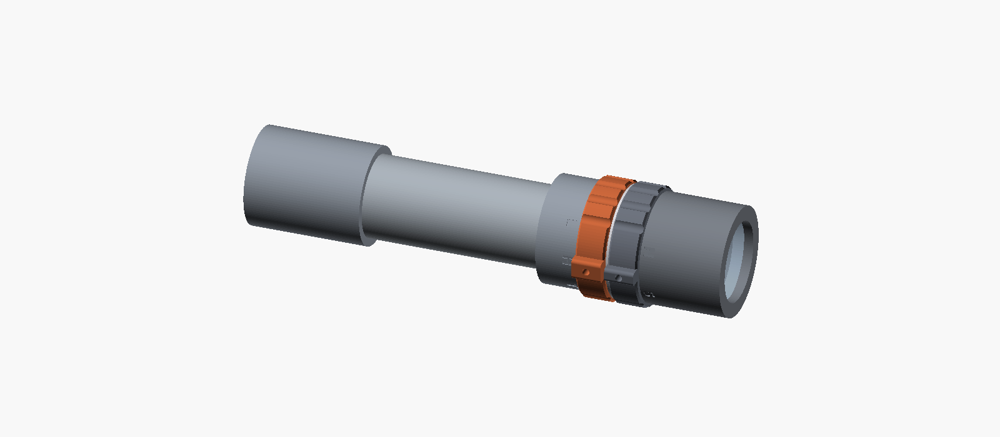
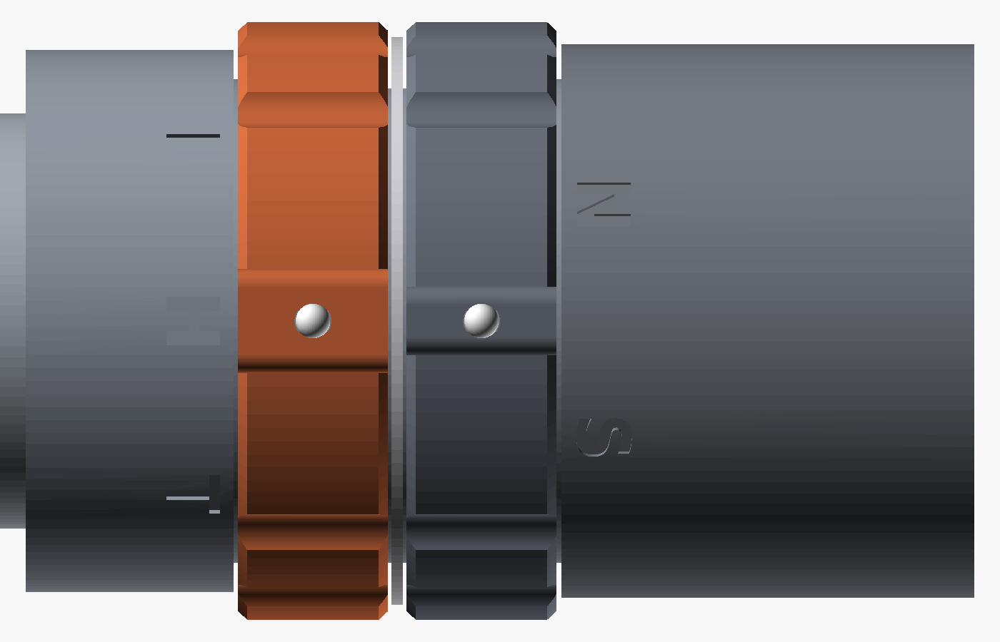
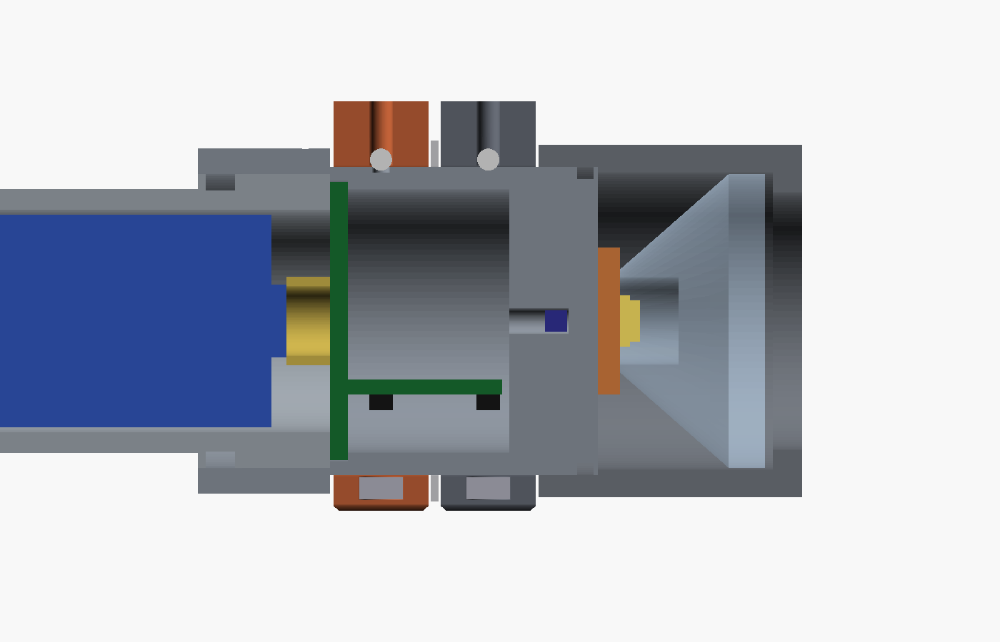

# flashlight

DIY 14500 EDC flashlight — work in progress (concept CAD, no hardware built yet).



## Features (planned)

- **14500 Li-ion** (AA size), unprotected cell, all protection on board
- **Two magnetic selector rings**, glove-usable, no holes in the housing:
  - rear ring: Low / High / Turbo
  - front ring: Normal / Strobe
  - read through the aluminium wall by 2× TMAG5273 3D Hall sensors, ball detents
- **Forward clicky** tail switch with true power cutoff, mechanical lockout by twisting the tailcap
- **USB-C charging in the tailcap** (IPX7 receptacle), charge path via a Schottky diode in the head
- **Nichia 519A** 5000K R9080 + Carclo 20 mm frosted TIR optic
- **ATtiny1616** driver, linear constant current (DAC + op-amp), thermal regulation via NTC behind the LED, low-voltage protection




## Repo layout

| Path | Content |
|---|---|
| `docs/flashlight-plan.md` | requirements, architecture, firmware spec, BOM, open decisions |
| `docs/sourcing.md` | where to buy what (DigiKey + Kaidomain) |
| `mech/` | parametric CadQuery model (all dimensions in `Params`) + render script |
| `firmware/` | ATtiny1616 firmware (stub), Makefile with SerialUPDI flash target |
| `hardware/` | KiCad project (not started) |
| `flake.nix` | Nix dev shell: avr-gcc, avrdude, pymcuprog, CadQuery venv |

## Usage

```sh
nix develop            # or: direnv allow
python mech/flashlight.py   # STEP/STL → mech/out/
python mech/render.py       # PNG previews → mech/out/render/
make -C firmware            # build
make -C firmware flash PORT=/dev/ttyUSB0
```

KiCad and OpenSCAD (used for the renders) are expected from the system.

## License

[WTFPL](LICENSE) — do what the fuck you want.
